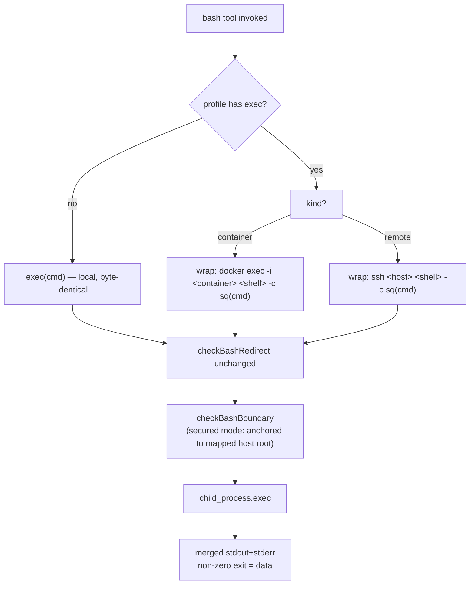
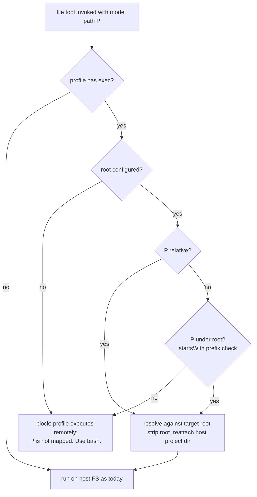
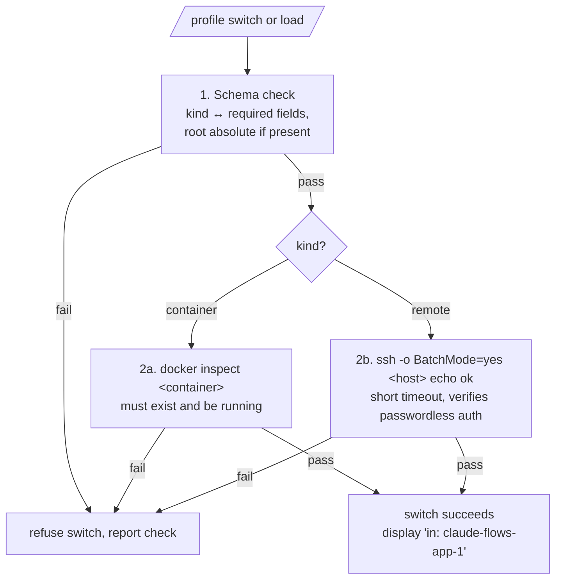

# Per-Profile Execution Targets — Design Document

Implementation design for `exec-targets-plan.md`. Bash executes on the target
(docker container / ssh host); file tools always operate on the host FS, mapped
through a single target project `root`.

## 1. Overview

A profile declares **where `bash` runs** and **how model paths map** to host
paths. Three kinds:

| Kind | Bash execution | File tools |
|------|---------------|------------|
| `local` (no `exec`) | `exec(cmd)` — unchanged | unchanged |
| `container` | `docker exec -i <container> <shell> -c <cmd>` | host FS via single `root` |
| `remote` | `ssh <host> <shell> -c <cmd>` | host FS via single `root` |

No Docker API, no remote FS protocol — bash is wrapped as a command string
through the existing `child_process.exec`.

## 2. Types

```ts
// packages/core/src/types.ts (~15 lines)
type ExecTarget =
  | { kind: "container"; container: string; shell?: string; root?: string }
  | { kind: "remote";    host: string;      shell?: string; root?: string };
```

```json
{
  "name": "profile1",
  "exec": {
    "kind": "container",
    "container": "claude-flows-app-1",
    "root": "/home/user/projects/app"
  }
}
```

- `root` = the **host-side folder** the docker volume is mounted from (e.g.
  `/home/user/docker-ws/data`). tiny-cli inspects the container's bind mounts
  to find where that folder lives inside the container (Source === `root` →
  Destination), and maps model paths (`/data/x`, relative) onto the host
  folder through that pair. `root` is used ONLY by the file tools — bash
  always executes inside the container and never touches `root`.
  For `remote` profiles there is no mount table to inspect, so an explicit
  `hostRoot` must accompany `root`, otherwise file tools are bash-only.
- `shell` defaults to `/bin/bash`; missing-shell errors surface verbatim so the
  user can set `/bin/sh` (Alpine).
- `root` absent → file tools blocked for that profile (bash-only).
- No `-t` flag anywhere — output pipes must stay clean for capture.

### SSH auth assumptions (remote kind)

Passwordless, non-interactive auth is a **hard requirement**: bash runs
`ssh <host> <shell> -c <cmd>` through `child_process.exec` with no PTY (no
`-t`), so a password/passphrase prompt would hang until timeout or fail
immediately. Supported setups:

1. **SSH key auth** — default key with empty passphrase, or a key loaded in
   `ssh-agent` (the normal case).
2. **`~/.ssh/config` entry** — `IdentityFile`/`User`/`Port`/`ProxyJump`
   preconfigured; the profile's `host` is passed verbatim to ssh, so all of
   ssh's config resolution (including bastion hosts) works for free.
3. Other non-interactive methods (GSSAPI, etc.).

**Prerequisite connection test:** validation runs
`ssh -o BatchMode=yes <host> echo ok` (short timeout) before a remote profile
can be activated. `BatchMode=yes` disables all prompting, so this probe
verifies passwordless auth specifically. Failure (`Permission denied`, timeout,
unknown host) → the profile switch is refused at `/profile` time with the
verbatim error, rather than hanging mid-conversation.

## 3. New module: `packages/core/src/tools/execTarget.ts` (~80 lines)

```ts
sq(cmd: string): string                  // single-quote wrap: ' → '\''  (~4 lines, unit-tested)
wrapBashCmd(target: ExecTarget, cmd: string): string
mapPath(target: ExecTarget, p: string): { ok: true; hostPath: string } | { ok: false; reason: string }
validateExecTarget(target: ExecTarget): Promise<void>  // throws with which check failed
```

### `wrapBashCmd`

```
local     → cmd
container → `docker exec -i ${container} ${shell} -c ${sq(cmd)}`
remote    → `ssh ${host} ${shell} -c ${sq(cmd)}`
```

Output/exit contract unchanged everywhere: merged stdout+stderr, non-zero exit
is data. `checkBashRedirect` unchanged (inspects model intent, target-independent).

### `mapPath` — single-root mapping

The agent normally emits **relative paths** (it runs with a cwd on the target),
so one mapping suffices:

- Relative path → resolve against the **container-side** mount point (from
  `docker inspect`), strip it, reattach the host `root` folder:
  `<root>/<relative>`.
- Absolute path → allowed only if it is under the container-side mount point
  (`startsWith` prefix check); same strip-and-reattach. Outside it, or no
  resolvable mount pair (`root` absent, or not a bind-mount Source, or remote
  without `hostRoot`) → block reason:
  `"profile1 executes remotely; <path> is not mapped on this host. Use bash."`
  Never fall back to the CLI's cwd or any other unrelated local directory.
- One shared helper used by all file tools — no per-tool logic.

### `checkBashBoundary` interaction

For container/remote profiles the model's paths are **target-side**
(`/data/...`), so secured-mode confinement anchors to the target root (the
container-side mount point); host paths are not the model's path space.

## 4. Bash tool flow



## 5. File tools flow

Applies to `read` / `write` / `grep` / `glob` / `list` / `search_replace` /
`insert_lines` — one helper call at the top of each handler.



## 6. Profile load / switch validation

Fail-fast at profile load and `/profile` switch; on failure the switch is
refused (previous profile retained) and the failing check reported.



## 7. Context plumbing

`profileToConfig` (`packages/cli/src/config.ts:160`) already builds the
`AgentConfig` — carry `execTarget` on it, thread into the tool `context`
alongside `securedMode`/`cwd` (the same seam the bash boundary already uses).
Switching profiles mid-conversation moves bash execution immediately because
the context is rebuilt per profile.

## 8. Edit sites

| # | File | Change |
|---|------|--------|
| 1 | `packages/cli/src/config.ts` (`AgentProfile`, ~line 15) | add `exec?: ExecTarget` field |
| 2 | `packages/core/src/types.ts` | `ExecTarget` type (~15 lines) |
| 3 | new `packages/core/src/tools/execTarget.ts` | `sq()`, `wrapBashCmd`, `mapPath`, `validateExecTarget` (~80 lines) |
| 4 | `packages/core/src/tools/defs/bash.ts:70-77` | wrap `cmd` via `wrapBashCmd` before existing `exec()`; pass mapped workspace root to `checkBashBoundary` |
| 5 | file tools via shared context | `mapPath` rewrite or block message — one helper call at top of each handler |
| 6 | profile switch path (`profileToConfig`, TUI `/profile`) | run `validateExecTarget`; display `(in: claude-flows-app-1)` |

## 9. Security surface

- `sq()` is the only new injection surface — unit-tested (quotes, `$`, `;`,
  `&&`, empty string, unicode).
- Unmapped paths never touch the host FS (block, not error-through).
- Secured-mode confinement re-anchors to the mapped host dir.

## 10. Out of scope

- Docker API / archive endpoints for container FS reads.
- Remote file access via scp/sftp — `root` mapping or bash-only instead.
- Bundling docker/ssh — must be on PATH; missing binary surfaces as the exec
  error, already readable.
- Windows quirks beyond PATH resolution.

## 11. Verification checklist

1. `pnpm build` clean.
2. Local profile (no `exec`): bash + file tools byte-identical to today.
3. `sq()` unit tests pass.
4. Container profile: `pwd` → `/app`; `read /app/file` returns host-mounted
   content; `bash mkdir /app/x` then `list /app` sees `x`.
5. Remote profile: same against the ssh host.
6. Block case: no `root` → `read /app/file` blocked, no host access.
7. Validation: stopped container → switch refused, previous profile retained.
8. `/profile` shows target; mid-conversation switch moves bash immediately.
9. `pnpm test` unchanged (user runs manually).
