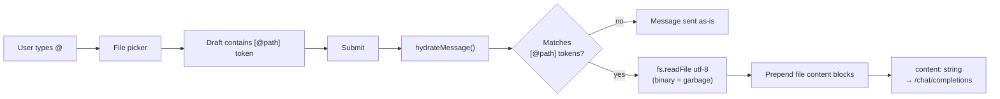
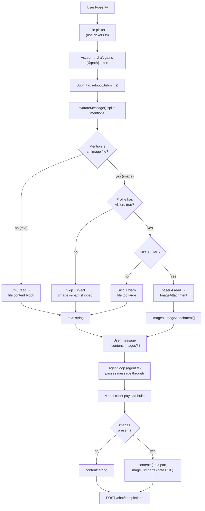
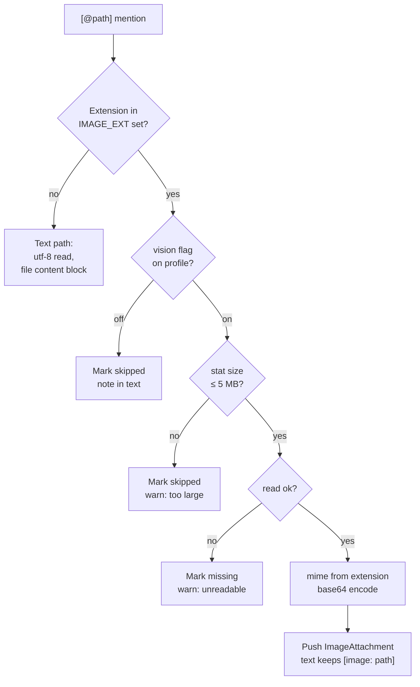
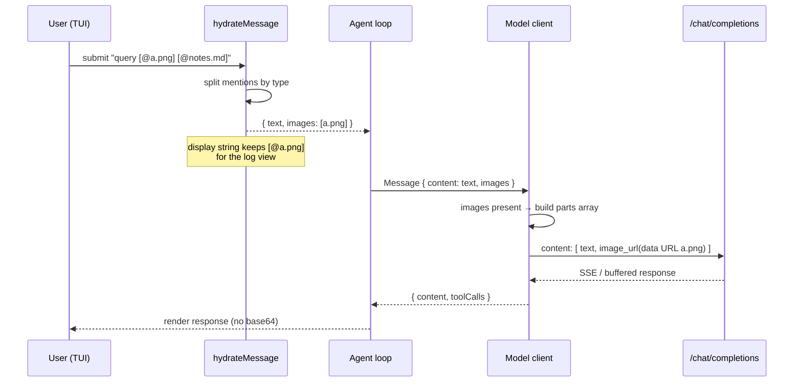
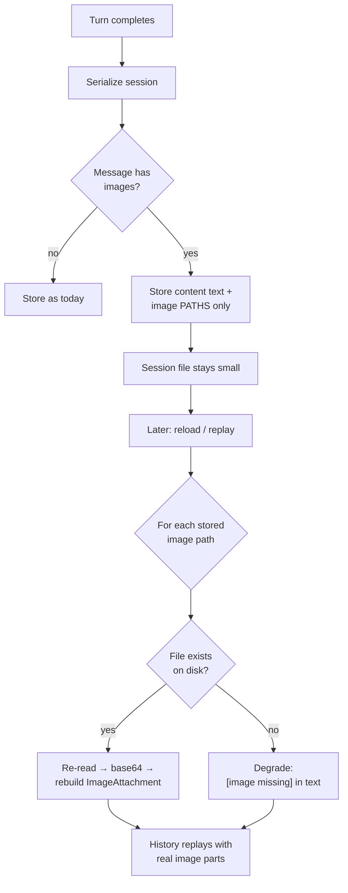

# Image Processing via `@` Mentions — Design

Send images referenced with the `@` file-mention picker alongside the user query,
when the active model supports vision. The model client speaks the
OpenAI-compatible `/chat/completions` protocol, which supports image input
natively via a content-parts array — no protocol change needed, only plumbing.

---

## 1. Current Behavior

- Typing `@` opens the file picker; accepting inserts a `[@path]` token
  (`packages/cli/src/tui/components/input/usePickers.ts`).
- On submit, `hydrateMessage()` (`packages/cli/src/file-mention.ts`) reads each
  mentioned file as **utf-8 text** and prepends
  `<file path="...">…</file>` blocks to the message.
- `Message.content` is a plain `string` end-to-end
  (`packages/core/src/types.ts`) — an image mention today hydrates to garbage
  bytes.



---

## 2. Proposed Design

### 2.1 Types (`packages/core/src/types.ts`)

Keep `content: string`; add an optional attachments field on the user message:

```ts
interface ImageAttachment {
  path: string;      // workspace-relative, as mentioned
  mimeType: string;  // image/png | image/jpeg | image/gif | image/webp
  data: string;      // base64, no data-url prefix
}

// on the user message:
images?: ImageAttachment[];
```

Everything downstream that assumes string content keeps working.

### 2.2 Hydration split (`packages/cli/src/file-mention.ts`)

`hydrateMessage()` returns `{ text, images }` instead of a string:

- Mentions with image extensions (`.png .jpg .jpeg .gif .webp`) are read as
  base64 into `images`; their spot in the text becomes `[image: path]` so the
  model knows what it is looking at.
- Text files behave exactly as today.

### 2.3 Client transform (`packages/core/src/model/client.ts`)

One shared point in payload building. When `images` is present, the user
message becomes a content-parts array:

```ts
content: [
  { type: 'text', text: message.content },
  ...images.map(i => ({
    type: 'image_url',
    image_url: { url: `data:${i.mimeType};base64,${i.data}` },
  })),
]
```

Both the streamed and buffered paths share payload construction, so a single
transform covers both.

**Wire-format notes:**

- Always emit the **object form** (`{"url": ...}`). It is the official OpenAI
  spec, accepted by every vision-capable OpenAI-compatible server (Ollama,
  vLLM, LM Studio, llama.cpp, OpenRouter, …). A bare-string shorthand
  (`"image_url": "data:..."`) is tolerated by some servers but rejected by
  strictly-compliant ones.
- Always use **data URLs** (inline base64). Local servers (Ollama, llama.cpp,
  LM Studio) generally only accept data URLs; hosted ones also accept `https://`
  URLs, but tiny-cli reads local files, so data URLs work for both.

**Verified (2026-10-14):** against a local `mlx-vlm` server on
`localhost:8080` — object-form data-URL payload returned HTTP 200 and the
model correctly described the image contents (a 1×1 red pixel → `"Red"`),
with the image counted in `prompt_tokens`.

### 2.4 Capability gating

Per-profile `vision: true` flag in config. When an image is mentioned but the
flag is off, hydration skips it and injects
`[image @path skipped — model has no vision]` — explicit behavior instead of a
cryptic API error. Default: off.

### 2.5 Display

The TUI must never render base64:

- Log view shows a `📎 path` placeholder. The display/sent split already keeps
  the raw `[@path]` for display (`useAgent.ts`), images ride the same split.
- Session persistence stores **path only**; replay re-reads from disk. Missing
  file degrades to `[image missing]`. Keeps session files small.

### 2.6 Estimator (`logView/estimator.ts`)

Exclude base64 from char-based token estimates; count each image as a flat
~800–1500 tokens.

---

## 3. Flow Diagrams

### 3.1 End-to-end flow



### 3.2 Capability + hydration decision flow



### 3.3 Request payload sequence



### 3.4 Session persistence and replay



---

## 4. Files Touched

| File | Change |
| --- | --- |
| `packages/core/src/types.ts` | `ImageAttachment`, optional `images` on user message |
| `packages/cli/src/file-mention.ts` | `hydrateMessage` → `{ text, images }`, image ext set, size cap, vision gating |
| `packages/cli/src/config.ts` | per-profile `vision` flag (default off) |
| `packages/core/src/model/client.ts` | payload transform to content-parts array |
| `packages/cli/src/tui/hooks/useAgent.ts` | thread `{ text, images }` into agent call |
| TUI log view | `📎 path` placeholder, never base64 |
| `logView/estimator.ts` | flat per-image token count |
| Session persistence | store paths only, re-hydrate on replay |

## 5. Testing Plan

- `file-mention`: unit tests — image vs text vs unknown extension; vision off →
  skip note; oversize → skip; unreadable → degrade.
- `model/client`: payload shape with/without images (text-only stays a plain
  string — no behavior change for existing sessions).
- Replay: session with image paths reloads; missing file degrades gracefully.
- Manual: `@screenshot.png` round-trip against a vision-capable endpoint.

## 6. Decisions (settled 2026-10-14)

1. **Capability flag** — explicit `vision: true` per profile (approved);
   default off. No auto-detection from model names, no send-and-see.
2. **Large images** — cap at ~5 MB with skip+warn.
3. **Estimate per image** — flat 800 tokens per attached image.
